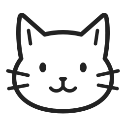
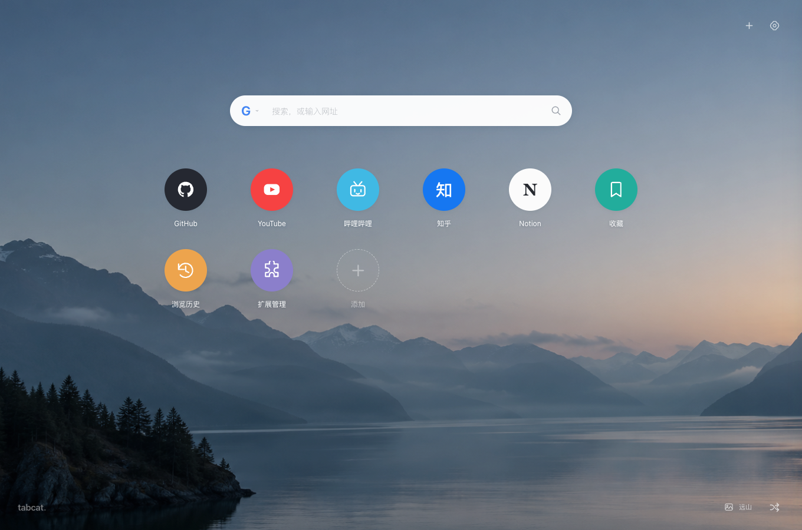

<p align="center">
  <a href="public/icon/tabcat.svg">
    
  </a>
</p>

<h1 align="center">TabCat</h1>

<p align="center">常用网站、随手记录和每日壁纸，都在新标签页。</p>
<p align="center">Chrome / Edge · 自定义桌面 · 本地保存 · MIT 开源</p>



TabCat 是一个可以按自己的习惯布置的浏览器新标签页。把每天要打开的网站放在手边，留一块地方记待办、看天气，再选一张喜欢的壁纸。打开浏览器，就能开始今天的事。

## 把常用的东西放在一起

**网站和小组件，共用一个桌面。**

在候选侧栏里搜索图标或小组件，点击即可添加，也可以直接拖到桌面。常用网站、AI 工具、社交平台，以及收藏、历史记录等浏览器入口，都能放在顺手的位置。网页组件填写嵌入地址后即可添加。

- **随手收藏**：浏览网页时点击 TabCat 工具栏图标，把当前页面添加到首页。
- **拖动整理**：拖动时显示浮动预览与落点提示，悬停片刻后其他图标才让位，松手后平滑调整顺序，网格自动补齐空位；误删后可以撤销。
- **轻松翻页**：按住桌面空白处左右拖动，或靠近左右边缘点击翻页按钮。
- **自由设置**：图标大小、圆角、间距、名称和文字样式都可以调整，也能使用自定义图片。

## 给日常留几个小工具

| 小组件 | 可以做什么 |
| --- | --- |
| 备忘、待办 | 备忘可存多条，打开后左侧列表、右侧编辑，卡片显示最新一条；待办查看完成进度 |
| 天气 | 自动定位或手动选城，按天气与日出日落切换卡片效果，缓存优先显示 |
| 时钟、日历 | 时钟随所选时区切换昼夜样式，日历突出今天和周末 |
| 倒数日 | 查看剩余天数，区分即将到来、当天和已经过去的日期 |
| 番茄钟 | 用进度环查看剩余时间，切换专注与休息、暂停或继续 |
| 计算器 | 输入算式快速计算，清晰显示结果和错误提示 |
| 网页 | 嵌入支持 iframe 的 HTTPS 工具页面，查看来源或独立打开 |

小组件可以调整标题和尺寸，和网站图标一起排列；2×2 等尺寸按对应行列图标图案的外沿对齐，不包含末行图标名称。点击小组件会弹出详情，右键可以打开、设置或移除。备忘、待办与计时状态保存在本机，刷新后也能继续使用。天气先显示本地缓存，每小时的 00、15、30、45 分钟按需更新；离线时保留上次天气和更新时间。日落后切换夜间配色与月亮，并按农历日期显示简化月相。

## 换一张壁纸，换一种心情

选择内置山海壁纸、Bing 每日壁纸或在线摄影图库，也可以上传自己的照片。支持定时轮换、模糊、磨砂和亮度调整，搭配浅色或深色设置面板。

搜索框支持 Google、Bing、百度和自定义搜索引擎，提供搜索建议。时钟、日期、农历和浏览器书签栏可以按需显示，让桌面保持你喜欢的样子。

## 不用注册，从本机开始

TabCat 无需注册账号，网站、桌面布局、小组件和设置保存在当前浏览器的本机存储中。

- 在「设置 → 数据」开启浏览器同步，登录同一浏览器账号的设备会自动同步网站、小组件、搜索引擎和设置；本地上传的壁纸只留在本机。上传的图标可以再连接 WebDAV（坚果云、Nextcloud、群晖等）同步到其他设备。
- 导出 JSON 备份，方便迁移或恢复桌面。
- 支持导入 Infinity 和 iTab 的兼容数据，导入前会展示预览与不支持的内容。
- 在线壁纸、搜索建议、天气和自动获取网站图标会访问对应服务；详情见 [网络资源说明](docs/network-sources.md)。

## 开始使用

目前可以从源码构建，并以开发者模式安装到 Chrome 或 Edge。

需要 Node.js 22.12+：

```sh
git clone https://github.com/keleus/TabCat.git
cd TabCat
npm install
npm run build
```

1. 打开 Chrome 的 `chrome://extensions/`，或 Edge 的 `edge://extensions/`。
2. 开启「开发者模式」，点击「加载已解压的扩展程序」。
3. 选择项目中的 `output/chrome-mv3` 文件夹。
4. 新建标签页，按浏览器提示保留 TabCat 的新标签页设置。
5. 将 TabCat 固定到浏览器工具栏，方便随时收藏网页。

安装后，点击右上角的小组件按钮开始布置桌面；右键图标或进入「编辑桌面」即可整理。更新代码并重新构建后，在扩展管理页点击「重新加载」。

## 了解更多

- [使用与开发指南](docs/guide.md)：详细设置、开发构建与测试说明
- [备份导入说明](docs/import-formats.md)：兼容格式与导入限制
- [插件说明](docs/store-listing.md)：商店上架文案、图片素材、权限理由与数据使用
- [网络资源与图标来源](docs/network-sources.md)
- [壁纸来源](docs/wallpaper-source.md)
- [TabCat 图标设计与 SVG 源文件](docs/brand/README.md)
- [反馈问题或提出建议](https://github.com/keleus/TabCat/issues)

## 许可证

[MIT License](LICENSE) · Copyright © 2026 keleus &lt;jen.hs@outlook.com&gt;

第三方图标与素材保留各自的许可证和署名。
